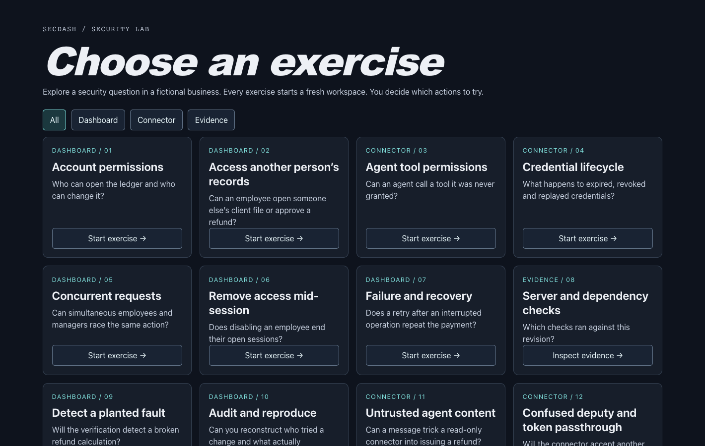

# SecDash

[Repeat the security checks (optional)](docs/security/campaign/README.md) · [Hosted results by exercise](https://github.com/k-mc-martin/example-dashboard/actions/workflows/hosted-exercises.yml) · [Campaign checks](https://github.com/k-mc-martin/example-dashboard/actions/workflows/campaign.yml)

[Earlier account review results](docs/security/accounts.md#hosted-account-review-november-10-2026) · [Repeat the account checks (optional)](docs/security/manual-review.md) · [Browse the source in VS Code](https://github.dev/k-mc-martin/example-dashboard) · [Deployed commit](https://vps-ca027b84.vps.ovh.us/version)

Under **Automated security review**, select **Run all 19 exercises**. The hosted runner opens the dashboard in Chromium, performs each scenario in a fresh workspace, and checks the server responses and their effects. When it finishes, select **Download suite results (PDF)**. The report identifies the tested build and shows which exercises passed, failed, or were incomplete, with the operations and evidence for each. Exercises 8, 13, and 15 inspect published checks for that build. You can refresh the picker to check progress and retrieve the report in the same browser for up to eight hours from the start of your run.

Under **Explore an exercise yourself**, pick a card. For an interactive exercise, select **Start exercise**, choose a fictional role, and try the actions in the dashboard. Expand **Latest server response** to inspect a decision. On an evidence card, select **Inspect evidence** to open **Verification results**. Select **Download exercise report (PDF)** before choosing another exercise. For example, the report can show that the server refused Mira’s refund approval with HTTP 403, the ledger stayed at `submitted`, and the provider issued zero refunds. As Owner, you can download receipts for both roles after approving the same refund as Inez.

SecDash lets you test how a business dashboard enforces security. You can try to approve a refund as an employee, revoke a team member’s access while they are signed in, or give a connector permission to read mail and then ask it to issue a refund. Each visitor gets a separate workspace with fictional accounts, records, and providers. Workspaces expire after eight hours. The optional manual review page gives the starting role, controls, and expected outcome for each exercise.

## Run locally

From a checkout with npm and Docker Compose available, run `npm run demo:up`, then open [the local dashboard](http://127.0.0.1:5286). Compose starts the dashboard, the automated runner, n8n, and the fictional providers. Only the dashboard publishes a port, bound to loopback. The demo supplies its own data and credentials. Run `npm run demo:down` to stop it.

If the default port is occupied, run `SECDASH_DEMO_PORT=5287 npm run demo:up` and open [the demo on port 5287](http://127.0.0.1:5287). Use the same environment variable when running HTTP verification. Member tabs use separate `*.localhost` hosts on the same loopback port.

## Data flow

**Generate new activity** asks the dashboard server for the next fictional update. n8n calls nine provider endpoints and returns their results together. The server validates the update and commits it to the visitor’s SQLite workspace. A retry of the same revision advances the workspace only once. If an update fails, the previous revision stays available. [n8n workflow](infra/n8n/workflows/demo-events.json) · [Fictional providers](infra/simulation/providers.mjs)

The feeds cover mail and feedback, accounts, sales and refunds, public and beta releases, deployment and object storage, signing, domains, drive usage, and recovery. Recovery includes backup libraries, restore checks, simulated automation executions and estimated model usage. Backup actions record simulated jobs. Download links serve sample manifests.

The other workflow exports are inactive templates with reserved fictional addresses. The demo stack imports only the simulation workflow.

## Demo accounts

**Mira Chen (Employee)** starts with Communications, Feedback, and Website & releases. **Theo Reed (Administrator)** can launch the published release to preview and run backups in exercise 1. In exercise 2 he can open his own client file. In exercise 5 he launches the same release twice concurrently and checks that only one deployment was recorded. Exercise 6 lets the Owner revoke his library-sync permission while he keeps working in the same tab. **Inez Park (Owner)** can manage the team and approve or deliver refunds. Each exercise adds its own dashboard actions. **Sign out** lets you change roles and keep the same records. To test two active identities, use **Teams** as Inez and open Mira’s session in a second tab. Choosing another exercise starts a fresh workspace. [Account policy and OWASP test mapping](docs/security/accounts.md)

## Verification

The optional manual review page describes all 19 exercises, the expected server decisions, and the evidence to inspect. For a local check, run `npm ci` and `npm run test:providers`. With the demo running, `npm run test:providers:http` checks provider behavior and isolation across two visitors, and `npm run verify:campaign` runs the campaign’s server tests.

With the demo running, `npm run verify:accounts` generates the account report and maps the results to their OWASP ASVS requirements and verification methods. The manual review worksheet covers all 70 ASVS 5.0.0 Level 1 requirements, including scope decisions that require a reviewer. [Account verification report](docs/security/evidence/accounts/report.md) · [Findings](docs/security/findings.md)

`npm run verify:tools` uses Docker Compose and Python 3 to run the security tools against a disposable demo and write results to `artifacts/security-tools/`. The hosted dashboard links its scanner, browser, and deployment evidence to the commit that produced it. [Tool setup, standards, and evidence](docs/security/toolchain.md)

